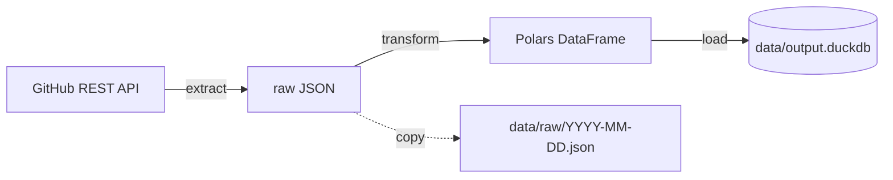

# scheduled-etl-project

[](https://github.com/marcogaudio/scheduled-etl-project/actions/workflows/schedule.yaml)
[](https://github.com/marcogaudio/scheduled-etl-project/actions/workflows/ci.yaml)

A small batch pipeline that runs every morning on GitHub Actions:

1. **Extract**: download metadata (stars, forks, license, language, timestamps) for a list of repositories from the GitHub REST API.
2. **Transform**: clean it with Polars, add a few derived columns and drop inactive repositories.
3. **Load**: write one row per repository per day into a DuckDB file, so the history grows over time.

Extract and load exist in two versions: one written by hand with `requests` and `duckdb`, one using the [dlt](https://dlthub.com) library. Both use the same Polars transform.

This is a learning project. Each module links to a short note in [`docs/concepts/`](docs/concepts) explaining the idea behind it, and [`docs/README.md`](docs/README.md) lists the notes in reading order.

## How it fits together



| File | Role |
|---|---|
| `config/config.toml` | which repositories to track, thresholds, database path |
| `src/config.py` | reads the TOML file and environment variables into a frozen `Settings` object |
| `src/extract.py` | GitHub client: pagination, retries, rate limits |
| `src/transform.py` | pure Polars functions: pick fields, fix types, derive columns, filter |
| `src/load.py` | writes the day's snapshot into DuckDB inside a transaction |
| `dlt_pipeline/pipeline.py` | the same extract and load, built with dlt |
| `src/main.py` | command-line entry point: runs the steps, logs them, sets the exit code |
| `.github/workflows/` | `schedule.yaml` (daily run) and `ci.yaml` (tests on every push) |
| `tests/` | 70 offline tests, one file per module |

## Setup

You need Python 3.11 or newer (CI uses 3.12).

```bash
git clone https://github.com/marcogaudio/scheduled-etl-project.git
cd scheduled-etl-project
python -m venv .venv
source .venv/bin/activate        # Windows: .venv\Scripts\Activate.ps1
pip install -r requirements.txt
```

A GitHub token is optional, but it raises the API limit from 60 to 5,000 requests per hour. Create a fine-grained token with read-only access to public repositories, then put it in a `.env` file at the project root (`.env` is already in `.gitignore`):

```
GITHUB_TOKEN=github_pat_...
```

## Configuration

`config/config.toml` holds everything that isn't secret. Any key can be overridden by an environment variable, and the load mode also by `--mode`. Priority, from highest to lowest: command line, environment, file, then the defaults in `src/config.py`.

| Key | Environment variable | Default |
|---|---|---|
| `github.repos` | `GITHUB_ETL_REPOS` (comma-separated) | none |
| `github.orgs` / `github.users` | `GITHUB_ETL_ORGS` / `GITHUB_ETL_USERS` | none |
| `github.per_page` | `GITHUB_ETL_PER_PAGE` | `100` |
| `transform.active_max_days_since_push` | `GITHUB_ETL_ACTIVE_MAX_DAYS` | `365` |
| `load.db_path` | `GITHUB_ETL_DB_PATH` | `data/output.duckdb` |
| `load.mode` | `GITHUB_ETL_LOAD_MODE` | `append` |
| (token) | `GITHUB_TOKEN`, environment only | none |

An empty variable counts as unset. `python -m src.config` prints the settings a run would use; the token is never printed.

## Running

```bash
python -m src.main                      # hand-written extract and load
python -m src.main --engine dlt         # dlt version (what the daily job runs)
python -m src.main --dry-run            # extract and transform, write nothing
python -m src.main --mode overwrite     # replace the whole table this time
python -m src.main --log-level DEBUG    # every API page and the remaining quota
```

Each step can also run on its own:
- `python -m src.extract` calls GitHub and saves the raw JSON.
- `python -m src.transform` and `python -m src.load` read the newest file in `data/raw/`, so they don't call GitHub.

Exit codes: `0` means success, `1` means the run failed (the log shows the traceback), `2` means a bad command-line option.

## Tests

```bash
pytest -v
```

The tests never use the network or the real database:
- GitHub's answers are faked with the `responses` library.
- Files go to temporary folders.
- The clock is fixed at 2026-10-31 12:00 UTC.

`ci.yaml` runs the tests on every push and pull request.

## Daily run

`.github/workflows/schedule.yaml` runs at 06:17 UTC every day:

1. Install the pinned requirements.
2. Run the tests.
3. Restore yesterday's `output.duckdb` from the Actions cache.
4. Run `python -m src.main --engine dlt`.
5. Save the database back to the cache.
6. Upload the database and the day's raw JSON as an artifact, kept for 30 days.

Useful to know:
- You can start it by hand from Actions → Daily GitHub ETL → Run workflow, and choose the load mode or a dry run.
- To change the tracked repositories without a commit, set the repository variable `GITHUB_ETL_REPOS`.
- Scheduled runs only start from the default branch. In public repositories, GitHub pauses them after 60 days without activity.

## Data model

`data/output.duckdb` keeps one row per repository per day. Running twice on the same day replaces that day's rows instead of adding more.

| Object | Contents |
|---|---|
| `main.repo_snapshots` | written by `--engine manual` (`src/load.py`) |
| `main.repos_latest` | view: only the newest day of `main.repo_snapshots` |
| `github.repo_snapshots` | written by `--engine dlt`; this is the table the daily job fills |
| `github._dlt_loads`, `_dlt_pipeline_state`, `_dlt_version` | dlt's own bookkeeping |
| `github_staging.*` | temporary tables dlt uses while merging |

Both `repo_snapshots` tables have the same columns:

| Column | Type | Meaning |
|---|---|---|
| `snapshot_date` | DATE | day of the run, in UTC |
| `id` | BIGINT | GitHub's permanent repository id |
| `full_name` | VARCHAR | `owner/name` |
| `owner_login` | VARCHAR | owner account |
| `language` | VARCHAR | main language, `Unknown` if GitHub has none |
| `license_spdx` | VARCHAR | SPDX id such as `MIT`; `NONE` if no license, `NOASSERTION` if GitHub couldn't identify it |
| `stargazers_count` | BIGINT | stars |
| `forks_count` | BIGINT | forks |
| `open_issues_count` | BIGINT | open issues **plus** open pull requests |
| `star_fork_ratio` | DOUBLE | stars ÷ forks; null when there are no forks |
| `topics` | `VARCHAR[]` (manual), `JSON` (dlt) | repository topics |
| `fork`, `archived`, `disabled` | BOOLEAN | repository flags |
| `created_at`, `updated_at`, `pushed_at` | TIMESTAMPTZ | creation, last metadata change, last push |
| `repo_age_days` | BIGINT | whole days since creation |
| `days_since_last_push` | BIGINT | whole days since the last push |

## Querying

```python
import duckdb

con = duckdb.connect("data/output.duckdb", read_only=True)
con.sql("SELECT snapshot_date, count(*) FROM github.repo_snapshots GROUP BY 1 ORDER BY 1")

# stars gained since the previous snapshot, per repository
con.sql("""
    SELECT snapshot_date, full_name, stargazers_count,
           stargazers_count - lag(stargazers_count)
               OVER (PARTITION BY id ORDER BY snapshot_date) AS stars_gained
    FROM github.repo_snapshots
    ORDER BY full_name, snapshot_date
""").pl()
con.close()
```

DuckDB allows only one process to write to a file at a time, so close connections before the next run.

## Troubleshooting

| Symptom | Fix |
|---|---|
| `ModuleNotFoundError: No module named 'src'` | Run from the project root with `python -m src.main`, not `python src/main.py`. |
| `GITHUB_TOKEN is not set` warning, or rate-limit errors | Put a token in `.env`. |
| `Could not set lock on file` | Another program has `output.duckdb` open for writing. Close it. |
| `Repository ... not found: skipped` | A typo in `config.toml`, or the repository was deleted or made private. |
| The daily workflow never starts | The workflow file has to be on the default branch. |

## More

- [`docs/README.md`](docs/README.md): the concept notes, in reading order
- [`docs/glossary.md`](docs/glossary.md): short definitions of the terms used
